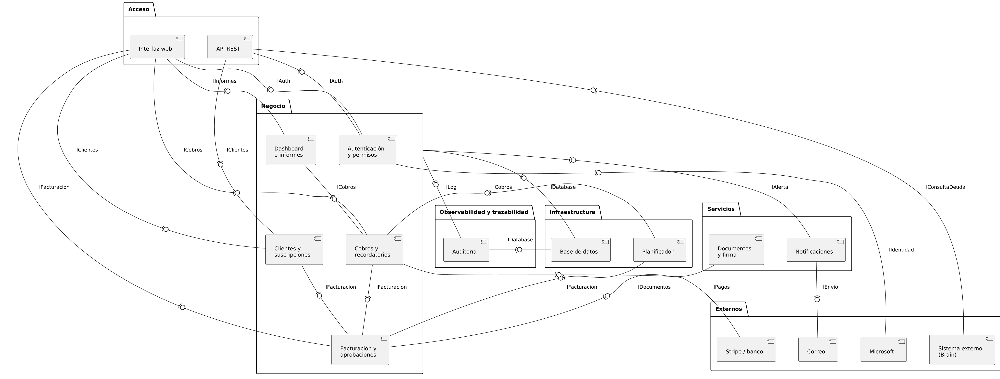

# **Documento del Diagrama de Componentes**

**Grupo:** Ramón Llull

**Curso:** 3º B

## **1. Descripción General y contextualización**

Este documento recoge la arquitectura lógica del gestor de facturas y clientes de TurbineH mediante un diagrama de componentes UML. Su finalidad es explicar de qué piezas se compone el sistema, qué ofrece y qué necesita cada una, qué requisitos del documento de requisitos cubre y por qué se han tomado las decisiones principales de diseño.

El diagrama es lógico: no fija tecnologías concretas (lenguaje, framework o gestor de base de datos), ya que esas decisiones corresponden a una fase posterior del proyecto. El código fuente está en `CodigoDiagramaComponentesV1.puml`.

La arquitectura se ha planteado por capas y basada en componentes, con dos objetivos: que cada componente tenga una responsabilidad clara (alta cohesión) y que se comuniquen entre sí solo a través de interfaces (bajo acoplamiento). Para ello el sistema se divide en seis paquetes:

* **Acceso.** Puertas de entrada al sistema: la interfaz web y la API. No contienen lógica de negocio.

* **Negocio.** Lógica de dominio: acceso y permisos, clientes, facturación, cobros e información financiera.

* **Servicios.** Módulos de apoyo: documentos con firma digital y notificaciones.

* **Infraestructura.** Persistencia de los datos y disparador de los procesos programados.

* **Observabilidad y trazabilidad.** Registro inalterable de la actividad del sistema (auditoría).

* **Externos.** Sistemas de terceros con los que se integra la aplicación.

## **2. Notación utilizada**

*Definición:* El diagrama usa la notación UML de interfaz ofrecida y requerida, que expresa las dependencias entre componentes a través de contratos y no de forma directa.

* **Sintaxis.** La expresión `A -(0- B : IX` significa que B ofrece la interfaz IX (el círculo) y A la requiere (el semicírculo). En la práctica, A depende de B, pero solo a través de IX.

* **Interfaces compartidas.** Una misma interfaz puede ser requerida por varios componentes. Por ejemplo, IFacturacion la usan la interfaz web, Clientes y suscripciones, Cobros y recordatorios y el Planificador.

* **Conexiones de paquete.** Cuando una línea sale del borde de un paquete, significa que todos los componentes de ese paquete usan la interfaz.

## **3. Componentes**

*Definición:* Piezas del sistema con una responsabilidad concreta y que se relacionan con el resto únicamente a través de las interfaces que ofrecen y requieren.

### **A. Acceso**

* **CP1. Interfaz web.** Aplicación que usan empleados y administradores desde escritorio, tablet o móvil. Solo canaliza las peticiones hacia el negocio, sin lógica propia. Requiere: IAuth, IClientes, IFacturacion, ICobros e IInformes. Requisitos relacionados: BR4, BR8, NFR1, NFR3.

* **CP2. API REST.** Entrada para sistemas externos. Antes de atender cualquier petición valida las credenciales y el rol técnico. Ofrece IConsultaDeuda y requiere IAuth e IClientes. Requisitos relacionados: BR9, UR18, FR2, FR28.

### **B. Negocio**

* **CP3. Autenticación y permisos.** Inicio de sesión (con correo corporativo o cuenta de Microsoft), gestión del ciclo de vida de los usuarios y control de acceso por roles. Ofrece IAuth y requiere IIdentidad. Requisitos relacionados: FR1, FR2, FR3, NFR4, NFR5.

* **CP4. Clientes y suscripciones.** Fichas de cliente y datos fiscales, contactos, asignaciones y delegaciones, importación y exportación en CSV, bajas, suscripciones, tarifas y excepciones comerciales. Ofrece IClientes y requiere IFacturacion. Requisitos relacionados: FR4 a FR11, UR1, UR4, UR10.

* **CP5. Facturación y aprobaciones.** Creación de facturas puntuales y recurrentes, numeración, estados, rectificación y flujo de aprobación de las operaciones económicas sensibles. Ofrece IFacturacion y requiere IDocumentos. Requisitos relacionados: FR12 a FR16, NFR7, NFR9, NFR10.

* **CP6. Cobros y recordatorios.** Vinculación de los pagos con las facturas, conciliación, cola de revisión manual de discrepancias y recordatorios automáticos de impago, incluida su pausa por disputa. Ofrece ICobros y requiere IFacturacion e IPagos. Requisitos relacionados: FR19, FR20, UR6, UR12.

* **CP7. Dashboard e informes.** Métricas financieras para administradores, informes, exportaciones y paquete periódico para la gestoría. Ofrece IInformes y requiere ICobros. Requisitos relacionados: BR6, FR24, FR25, UR13.

### **C. Servicios**

* **CP8. Documentos y firma.** Genera el PDF de cada factura, le aplica la firma digital con el certificado electrónico y lo conserva exactamente como se emitió, con almacenamiento redundante en local y en la nube. Ofrece IDocumentos. Requisitos relacionados: FR17, NFR11.

* **CP9. Notificaciones.** Único punto de salida de avisos del sistema: notificaciones internas para los empleados y correos para los clientes. Ofrece IAlerta y requiere IEnvio. Requisitos relacionados: FR18, FR21, FR27.

### **D. Infraestructura**

* **CP10. Base de datos.** Persistencia de los datos estructurados, con transacciones ACID para evitar duplicidades e inconsistencias contables. Ofrece IDatabase. Requisitos relacionados: NFR7, NFR9, NFR13.

* **CP11. Planificador.** Dispara los procesos programados por fecha: la facturación recurrente del día 1 de cada mes y la revisión de recordatorios y vencimientos. Requiere IFacturacion e ICobros. Requisitos relacionados: FR13, FR19.

### **E. Observabilidad y trazabilidad**

* **CP12. Auditoría.** Registro inalterable de las acciones económicas, de clientes y de permisos (quién, qué y cuándo, con valor anterior y nuevo). Solo permite consulta, nunca edición. Ofrece ILog y requiere IDatabase. Requisitos relacionados: BR3, FR26, NFR8.

### **F. Externos**

* **CP13. Microsoft.** Cuenta corporativa para iniciar sesión. Ofrece IIdentidad. Requisitos relacionados: FR1.

* **CP14. Stripe / banco.** Pasarela de pago (simulada en el proyecto) y movimientos bancarios como los de Revolut. Ofrece IPagos. Requisitos relacionados: FR20.

* **CP15. Correo.** Proveedor de envío de correos, con WhatsApp simulado como canal complementario. Ofrece IEnvio. Requisitos relacionados: FR18.

* **CP16. Sistema externo (Brain).** Sistema de terceros que consulta la API. En este caso es solo consumidor: requiere IConsultaDeuda y no ofrece ninguna interfaz. Requisitos relacionados: BR9, UR18, FR28.

## **4. Interfaces**

*Definición:* Contratos mediante los cuales los componentes se piden servicios entre sí, sin conocer su implementación interna.

* **IAuth.** La ofrece Autenticación y permisos. La requieren la interfaz web y la API. Sirve para validar credenciales, roles y permisos.

* **IClientes.** La ofrece Clientes y suscripciones. La requieren la interfaz web y la API. Sirve para gestionar clientes y suscripciones.

* **IFacturacion.** La ofrece Facturación y aprobaciones. La requieren la interfaz web, Clientes y suscripciones, Cobros y recordatorios y el Planificador. Sirve para emitir y consultar facturas.

* **ICobros.** La ofrece Cobros y recordatorios. La requieren la interfaz web, Dashboard e informes y el Planificador. Sirve para gestionar y consultar los cobros.

* **IInformes.** La ofrece Dashboard e informes. La requiere la interfaz web. Sirve para consultar métricas y generar informes.

* **IDocumentos.** La ofrece Documentos y firma. La requiere Facturación y aprobaciones. Sirve para generar, firmar y conservar el PDF de una factura.

* **IAlerta.** La ofrece Notificaciones. La requiere el paquete Negocio. Sirve para solicitar un aviso.

* **IDatabase.** La ofrece Base de datos. La requieren el paquete Negocio y Auditoría. Sirve para guardar y consultar datos.

* **ILog.** La ofrece Auditoría. La requiere el paquete Negocio. Sirve para registrar acciones.

* **IIdentidad.** La ofrece Microsoft. La requiere Autenticación y permisos. Sirve para iniciar sesión con la cuenta corporativa.

* **IPagos.** La ofrece Stripe / banco. La requiere Cobros y recordatorios. Sirve para recibir pagos y movimientos.

* **IEnvio.** La ofrece Correo. La requiere Notificaciones. Sirve para enviar correos.

* **IConsultaDeuda.** La ofrece la API REST. La requiere el sistema externo (Brain). Sirve para consultar la deuda de un cliente y notificar una solicitud de baja.

## **5. Decisiones de diseño**

*Definición:* Criterios que se han seguido al construir el diagrama, con el motivo de cada uno y los requisitos que los justifican.

* **DD1. La capa de acceso no tiene lógica de negocio.** La interfaz web y la API se limitan a canalizar peticiones. Ambas pasan por IAuth porque el sistema debe autorizar en un único punto, tanto desde la interfaz como desde la API. La API solo necesita IAuth e IClientes, porque las operaciones externas previstas (consultar deuda y notificar una baja) giran en torno al cliente. Requisitos relacionados: FR2, FR28.

* **DD2. Agrupación de funcionalidades en los componentes de negocio.** Para que el diagrama se pueda leer, se han agrupado funcionalidades que comparten datos y dependencias. Las suscripciones y tarifas van dentro de Clientes, porque la suscripción es la ficha comercial del cliente. Las aprobaciones van dentro de Facturación, porque deciden si una factura puede emitirse. Los recordatorios van dentro de Cobros, porque ambos forman el ciclo de recobro. Es una decisión de nivel de detalle: la funcionalidad se mantiene dentro del componente que la contiene. Requisitos relacionados: FR9, FR10, FR16, FR19, FR20.

* **DD3. Conexión de paquete para base de datos, auditoría y avisos.** El paquete Negocio se conecta como conjunto a IDatabase, ILog e IAlerta. Se entiende que todos sus componentes guardan datos, registran sus acciones y generan avisos a través de esas interfaces. Así se reduce el número de líneas sin perder rigor.

* **DD4. La auditoría es un aspecto transversal.** Toda acción económica, de clientes o de permisos debe quedar registrada y no puede modificarse después. Por eso Auditoría tiene su propio paquete y actúa como observador independiente de la lógica de dominio. Guarda sus registros en la base de datos mediante IDatabase. Requisitos relacionados: BR3, FR26, NFR8.

* **DD5. Documentos y firma como servicio independiente.** Facturación entrega los datos de la factura y este componente se encarga de generar el PDF, firmarlo y conservarlo en el almacenamiento redundante. Facturación no necesita conocer cómo se firma ni dónde se guarda. Por eso el almacenamiento queda como parte interna del componente y no se dibuja por separado. Requisitos relacionados: FR17.

* **DD6. Notificaciones como único punto de salida de avisos.** Los componentes de negocio piden los avisos mediante IAlerta y Notificaciones decide el destino: avisos internos a los empleados, que reciben solo los de sus clientes, o correos a los clientes a través del proveedor de correo. El negocio queda aislado de los detalles del envío. Requisitos relacionados: FR18, FR19, FR21.

* **DD7. El Planificador depende del negocio.** Aunque está en Infraestructura, sus dependencias van hacia Facturación y Cobros, porque es quien arranca los procesos programados: la facturación recurrente mensual, que debe recuperar las ejecuciones perdidas sin duplicar facturas, y la revisión de recordatorios y vencimientos. Requisitos relacionados: FR13, FR19.

* **DD8. Los sistemas externos quedan tras interfaces.** Los componentes internos consumen interfaces sin conocer la implementación real del proveedor. Si un proveedor falla o se sustituye, solo se ve afectado un componente, y un fallo externo nunca corrompe una factura. Los movimientos por transferencia se han agrupado junto a Stripe en un único componente. Requisitos relacionados: FR1, FR18, FR20, FR28.

* **DD9. Brain consume la API, no al revés.** La aplicación es independiente de Brain: es Brain quien consulta la API mediante IConsultaDeuda. De esta forma se cumple el requisito de independencia y se deja preparada la integración futura. Requisitos relacionados: BR9, FR28.

* **DD10. Dependencias entre módulos de negocio.** Hay tres dependencias directas. Clientes y suscripciones usa Facturación para comprobar las facturas pendientes antes de una baja y para facturar las suscripciones. Cobros usa Facturación porque una factura pasa a pagada tras un cobro validado. Dashboard usa Cobros para consultar el estado de cobro. Para evitar una dependencia circular, Facturación no requiere IClientes: los datos fiscales del cliente que necesita al emitir los lee de la base de datos común. Requisitos relacionados: FR9, FR11, FR12, FR14, FR20.

## **6. Trazabilidad con los requisitos**

*Definición:* Relación entre los requisitos funcionales y no funcionales y el componente que los cubre.

* **FR1, FR2, FR3.** Autenticación y permisos.

* **FR4 a FR11.** Clientes y suscripciones.

* **FR12 a FR16.** Facturación y aprobaciones.

* **FR13.** Lo dispara el Planificador y lo ejecuta Facturación.

* **FR17.** Documentos y firma.

* **FR18.** Facturación decide el envío y Notificaciones lo realiza.

* **FR19, FR20.** Cobros y recordatorios.

* **FR21.** Notificaciones.

* **FR24, FR25.** Dashboard e informes.

* **FR26.** Auditoría.

* **FR28.** API REST y paquete Externos.

* **NFR7, NFR9.** Base de datos.

* **NFR8.** Auditoría.

## **7. Alcance y limitaciones**

El diagrama representa los componentes principales a un nivel abstracto. Algunas funcionalidades no aparecen como componentes independientes, sino dentro de los de negocio:

* **Incidencias (FR22).** Se resuelven dentro de Clientes y suscripciones y de Cobros y recordatorios, que gestiona la pausa de recordatorios.

* **Búsqueda avanzada (FR23).** Cada componente de negocio la ofrece sobre sus propios datos, respetando los permisos del usuario.

* **Configuración, plantillas y salud del sistema (FR27).** Los parámetros se guardan en la base de datos y los componentes de negocio los leen. No se ha dibujado un panel de configuración aparte.

Además, Notificaciones (estados de leído y atendido, plantillas) no tiene dibujada su propia conexión a la base de datos y se asume que guarda sus datos mediante IDatabase, igual que el resto. Quedan fuera del diagrama, por ser decisiones de implementación posteriores, las tecnologías concretas, la estrategia de copias de seguridad (NFR11) y la forma de despliegue.
