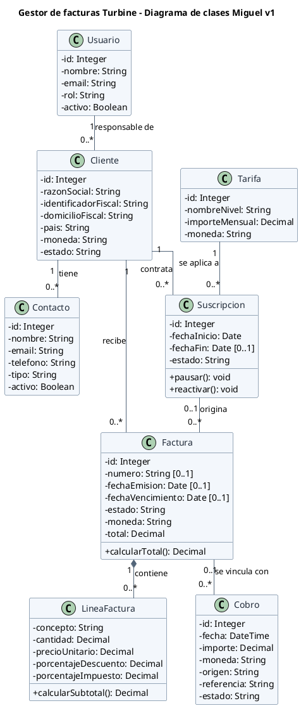

# Diagrama UML de clases — Primera versión Miguel

## Decisiones principales

- Se utiliza una única clase `Usuario` con un atributo `rol` para distinguir entre usuario estándar, administrador y superadministrador.
- `Cliente` representa a la empresa y `Contacto` a sus personas de contacto. Cada cliente tiene un responsable.
- `Suscripcion` y `Tarifa` se separan para que varias suscripciones puedan utilizar una misma tarifa. 
- Una misma clase `Factura` representa las facturas puntuales y recurrentes. Su relación con `Suscripcion` es opcional, y el número y las fechas pueden estar vacíos mientras sea un borrador.
- Las líneas pertenecen exclusivamente a una factura, por eso se utiliza composición. Se permiten borradores sin líneas, pero la emisión deberá exigir al menos una. Cada línea conserva el precio, descuento e impuesto aplicados.
- `Cobro` se separa de `Factura` para representar pagos pendientes de conciliación. Como simplificación inicial, cada cobro puede vincularse como máximo con una factura.
- Los importes utilizan `Decimal` para evitar errores de precisión. Los roles y estados se representan como `String`; sus valores se concretarán en una versión posterior.