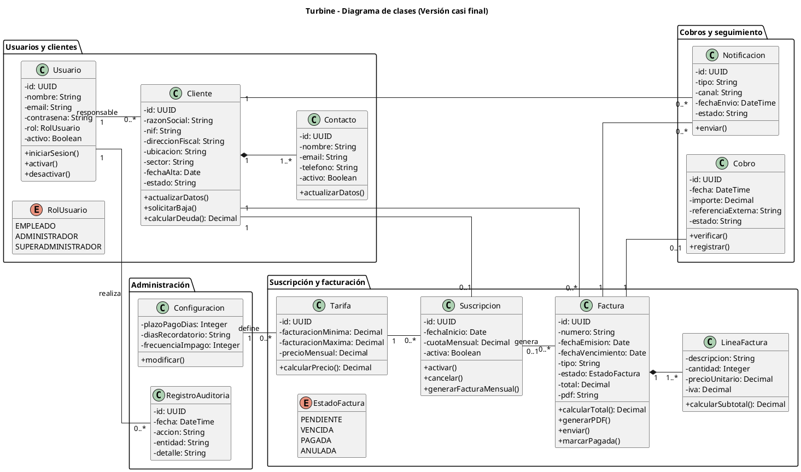

# Diagrama de clases — Turbine

## Versión 2 Miguel

La idea es que el diagrama represente el **modelo del sistema**, no cada caso de uso como una clase independiente.

## Clases principales añadidas o completadas

- **Usuario:** representa a los empleados internos. El rol distingue Empleado, Administrador y Superadministrador.
- **Cliente:** almacena los datos principales de cada empresa cliente.
- **Contacto:** representa a las personas de contacto asociadas a un cliente.
- **Suscripcion:** representa la facturación mensual de un cliente.
- **Tarifa:** determina la cuota mensual según el rango de facturación.
- **Factura:** representa tanto facturas puntuales como las generadas desde una suscripción.
- **LineaFactura:** contiene los conceptos que forman una factura.
- **Cobro:** registra el pago comprobado mediante la fuente externa.
- **Notificacion:** representa el envío de facturas y recordatorios.
- **Configuracion:** recoge parámetros generales como el plazo de pago y la frecuencia de recordatorios.
- **RegistroAuditoria:** conserva las operaciones importantes realizadas por los usuarios.

## Relaciones importantes

- Un **Usuario** puede ser responsable de varios **Clientes**, mientras que cada cliente tiene un responsable principal.
- Un **Cliente** tiene uno o varios **Contactos**.
- Un cliente puede tener una **Suscripción** o funcionar únicamente mediante facturas puntuales.
- Una **Tarifa** puede utilizarse en muchas suscripciones.
- Un cliente puede tener muchas **Facturas**.
- Una suscripción puede generar muchas facturas mensuales.
- Una factura contiene una o varias **Líneas de factura**.
- Una factura puede tener un **Cobro** asociado.
- Una factura y un cliente pueden tener múltiples **Notificaciones**.
- Las acciones importantes realizadas por los usuarios quedan reflejadas en **RegistroAuditoria**.

---

# PlantUML completo

